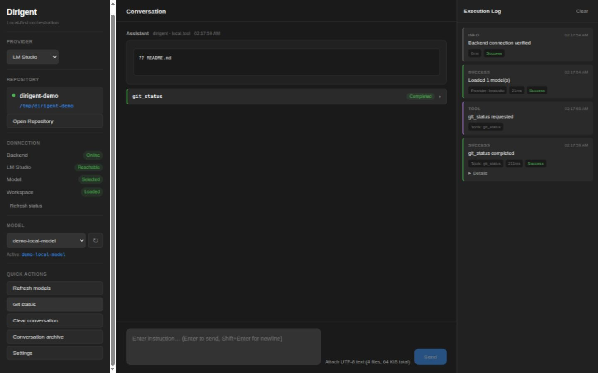
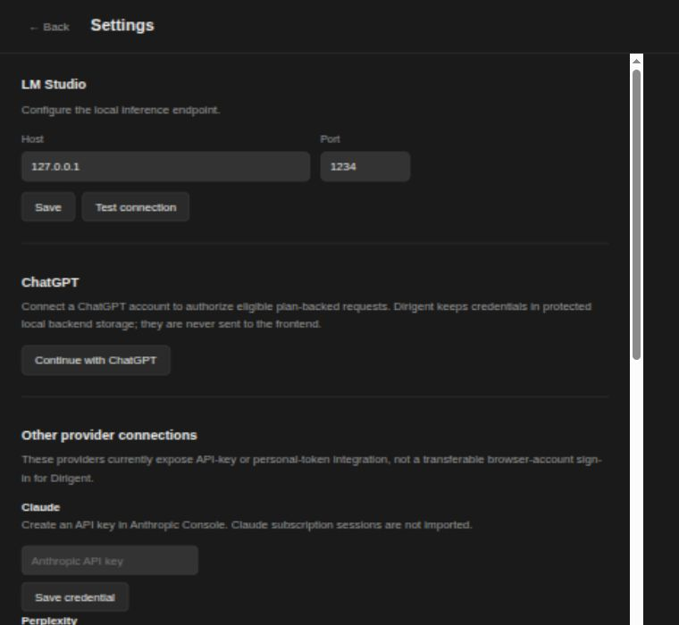

<div align="center">
  

  # Dirigent

  **A local workspace for model-assisted software development.**

  Work across a repository, inspect each action, and keep conversations in a portable archive.

  [Get started](#get-started) · [Features](#features) · [Architecture](#how-it-works) · [Documentation](docs/README.md)
</div>

---

Dirigent brings a repository, conversation, provider selection, and execution log into one desktop interface. The application runs a React/Tauri frontend with a local FastAPI service. It supports LM Studio, a ChatGPT account connection, and direct Claude and Perplexity API routes. Local file and Git operations pass through an explicit tool layer; model-suggested writes and Git changes require confirmation.

> **Project status:** Dirigent is under active development. The local workflow and provider adapters are implemented, but packaged releases, cross-platform validation, and live verification of every provider route are still in progress. See [current state](docs/current_state.md) for exact coverage.

## Preview



<sub>Development build shown with a sample repository and a local test model endpoint. No external provider account is shown.</sub>

<details>
<summary>Provider settings</summary>



<sub>Configuration screen with empty credential fields.</sub>
</details>

## Features

| Area | What is available |
| --- | --- |
| Workspace | Open a local repository, inspect Git status, read files, and review tool activity in the execution log. |
| Providers | Choose a local LM Studio model or connect supported hosted routes: ChatGPT, Claude API, and Perplexity API. |
| Action control | Model-suggested reads and Git status can run directly; writes and Git mutations require confirmation. |
| Conversation archive | Search and reopen local conversations. Export and import encrypted `.dpa` archives containing Parquet data. |
| Text attachments | Add up to four UTF-8 files to a prompt, with a 32 KiB per-file and 64 KiB combined limit. |

Provider availability depends on your local service, account, or API credentials. Cursor, Devin, and OpenClaw appear in the capability catalog, but their session and artifact routes are not enabled. [Integration status](docs/current_state.md) distinguishes implemented code from live-tested connections.

## Get started

### Requirements

- Python 3.12 or newer
- Node.js 20.19+ or 22.12+
- Rust and the [Tauri system prerequisites](https://v2.tauri.app/start/prerequisites/) for desktop development
- LM Studio with a loaded model for the local inference route, or credentials for a supported hosted route

### Install

From the repository root:

```bash
python -m venv .venv
source .venv/bin/activate        # Windows: .venv\Scripts\activate
pip install -r backend/requirements.txt
cd frontend && npm ci
```

### Run

On Windows, run `run_dirigent.bat` after installation. It starts or reuses the backend, checks `/health`, and launches the desktop app. `run_dirigent.ps1 -BackendOnly` starts only the backend.

On Linux, use the [development launcher](linux-v1/README.md):

```bash
./linux-v1/run_dirigent.sh
```

For a manual development session, run these in separate terminals from the repository root:

```bash
python run_backend.py
```

```bash
cd frontend
npm run tauri dev
```

The backend listens on `http://127.0.0.1:8000` by default. Its OpenAPI reference is available at `http://127.0.0.1:8000/docs` while it is running.

## How it works

```text
Desktop UI ──► local FastAPI service ──► selected model provider
    │                    │
    │                    ├──► action policy ──► filesystem / Git tools
    │                    └──► local SQLite archive ──► encrypted .dpa transfer
    └──► visible confirmations and execution log
```

Provider adapters return text and metadata. A separate execution layer parses proposed tool calls, applies policy, and records the outcome. The archive stores conversations locally and supports passphrase-protected export. This boundary is described in the [architecture](docs/architecture.md) and [tool execution contract](TOOL_EXECUTION_CONTRACT.md).

### Data and credentials

- Conversations are stored in a local SQLite database in the platform application-data directory.
- `.dpa` exports are encrypted with a passphrase; losing it makes an export unrecoverable.
- API keys can be supplied through environment variables or the local credential store. `ANTHROPIC_API_KEY` and `PERPLEXITY_API_KEY` take precedence over saved credentials.
- Text attachments are included in the selected provider request and retained in the local archive. Review files before sending them to a hosted provider.
- A saved credential is not proof of successful API access. Provider model discovery and requests still need a working account and connection.

## Development

Run the offline backend checks and frontend build from the repository root:

```bash
XDG_CONFIG_HOME=$(mktemp -d) .venv/bin/python -m unittest discover -q
cd frontend && npm run build
```

The temporary config directory keeps tests away from a personal archive. The [Linux launcher smoke test](linux-v1/README.md#test) runs separately and briefly uses port 8000.

## Documentation

- [Product scope and boundaries](docs/vision.md)
- [Current implementation status](docs/current_state.md)
- [Architecture and trust boundaries](docs/architecture.md)
- [Roadmap](docs/roadmap.md)
- [Contributor guide](docs/handoff.md)

## License

Released under the [MIT License](LICENSE).
